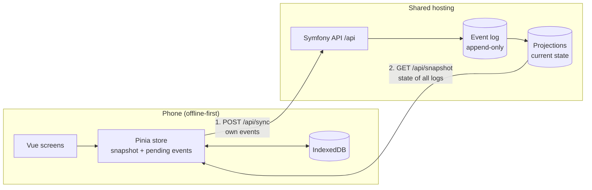

# V29 Stamm-Tracker

An offline-first web app for tracking around 1,300 oak logs – and the beams sawn from them – from the forest to their place in a building.

Built pro bono for **V29**, a collective of architects building a publicly funded residential house in Leipzig from their own low-grade oak ("Schwachholz"). Every log carries a numbered metal tag. Until now, the numbers lived on labels and in an Excel sheet. The Stamm-Tracker replaces that: people in the field capture each log's attributes on their phone, and the data is collected centrally for project management and the research attached to the project.

## How it works

**Capture app** (mobile-first Progressive Web App, installed on the phone's home screen)

1. Type the tag number on a large on-screen number pad – usable with gloves, no barcode scanning.
2. The app shows the log if it already exists, or offers to create it.
3. Record attributes and photos.
4. Split a log into beams. Beams inherit attributes from their log unless they have their own value.
5. Sync by hand once there is a connection: own changes go up, the current state of all logs comes down.

Everything is stored on the device first. Out in the woods there is usually no network, so the app works fully offline – including looking up what is already known about a log. New versions install themselves as soon as no unsaved input would be lost.

**Administration** (desktop-first, online only, served below `/admin`; so far a skeleton behind the sign-in): manage attributes, correct or void entries, manage users, evaluate and export data. Until then, these tasks run as console commands.

## Design decisions

- **Offline-first with manual upload.** Own entries leave the phone only when someone taps the sync button – people should know when their data has left the phone. Only the download of the current state runs by itself. No background sync (unreliable on iOS).
- **Append-only event log.** Nothing is ever updated or deleted. Every change is an event; corrections and voids are new events. The current state of each log is a projection computed from the events and can be rebuilt at any time.
- **Attributes are configuration, not code.** Everything domain-specific – even the wood species – is an attribute V29 defines themselves. A new process step needs no deployment and no migration.
- **Client-generated IDs.** Every log and every event gets a UUID on the device, so re-sending after a failed sync is harmless. The tag number is a label, not the key.
- **Personal invite codes instead of passwords.** Each person gets a code that signs them in for good; it can be revoked individually.
- **Same origin for app and API.** No CORS, plain session cookies.
- **Boring hosting.** Runs on standard shared hosting (Apache, PHP, MariaDB); no Node.js on the server.



## Tech stack

| Part | Technology |
|---|---|
| Capture app | Vue 3, TypeScript, Pinia, Vue Router, Tailwind CSS 4, vite-plugin-pwa, IndexedDB |
| Administration | Vue 3, TypeScript, Vue Router, Tailwind CSS 4 (separate project, no service worker) |
| API | PHP 8.4, Symfony 8, Doctrine ORM and Migrations |
| Database | MariaDB 11.8 |
| Tests | Vitest, Vue Test Utils, Playwright, PHPUnit |
| Tooling | DDEV, ESLint, Prettier, PHP CS Fixer, PHPStan, GitHub Actions |

## Repository layout

```
.
├── backend/     Symfony JSON API under /api, console commands, attribute definitions (data/)
├── frontend/    npm workspace: app/ (Vue capture app), admin/ (administration), shared/ (API contract, fixtures, design values)
├── docs/        clickable prototype and static screens from the design phase
├── .ddev/       local development environment
└── .github/     checks and deployment workflows
```

The API contract lives in `frontend/shared/contract.ts`. Its JSON fixtures (`frontend/shared/fixtures/`) serve both as mock data for the app and as expected results in the backend tests, so frontend and backend cannot drift apart unnoticed.

## Local development

Requirements: [DDEV](https://ddev.com) with a Docker provider (for example OrbStack). Every command runs inside the container.

```sh
ddev start
ddev composer install
ddev frontend install
ddev console doctrine:migrations:migrate -n
ddev console app:user:create "Name" --role=superadmin   # prints the invite code once; roles: user (default), admin, superadmin
ddev console app:attributes:import data/attributes.yaml
ddev frontend run dev          # capture app; the administration: ddev frontend run dev:admin
```

- Administration: https://v29-stamm-tracker.ddev.site:5174/admin/
- App: https://v29-stamm-tracker.ddev.site:5173 – uses a fake API with the fixtures by default; set `VITE_API=` in `frontend/app/.env.development.local` for the real backend.
- API: https://v29-stamm-tracker.ddev.site/api/ping

| Task | Command |
|---|---|
| Frontend tests / end-to-end tests (app and administration) | `ddev frontend run tests` / `ddev frontend run test:e2e` |
| Build incl. type check (app and administration) | `ddev frontend run build` |
| Backend tests | `ddev phpunit` |
| Static analysis (backend) | `ddev phpstan` |
| Lint / format | `ddev frontend run lint`, `ddev frontend run format`, `ddev php-cs-fixer fix` |
| Symfony console | `ddev console …` |

### Roles and sign-in

- `user` – the capture app only. `admin` – additionally the administration. `superadmin` – like `admin`; there is at most one (`app:user:create` and `app:user:role` refuse a second).
- The administration signs in with the same invite codes as the app (`/admin/login`) and lets in `admin` and `superadmin` only; `GET /api/admin/me` and everything else below `/api/admin/` answers 403 for `user`.
- The app and the administration share the sign-in cookie: signing out in the administration signs the app out in the same browser too.

### Console commands

Every command explains its options with `--help`; bulk changes, imports and voids offer `--dry-run`. The commands that write events (`app:attribute:set`/`clear`, `app:item:void`/`restore`, `app:photo:import`) record them under the superadmin and stop without a change if there is no active one.

| Command | Purpose |
|---|---|
| `app:user:create` / `list` / `revoke` | Manage users and invite codes (`create --role=user, admin or superadmin`) |
| `app:user:role <name or ID> <role>` | Change the role of an active user |
| `app:attributes:import` | Create and update attributes from YAML; every entry must state `is_series`, `is_inheritable`, `applies_to` (`stem` and/or `beam`: where the app offers the attribute for input) and `hidden_when` (keys of yes/no attributes: while one of them is "ja", the app hides the attribute; may be empty), see `backend/data/attributes.example.yaml` |
| `app:attribute:set` / `clear` | Set or clear one attribute on many logs |
| `app:item:void` / `restore` | Void a log or beam created by mistake, or undo that |
| `app:photo:import` | Attach existing photos from a CSV |
| `app:export` | Evaluation (round wood, sawn timber, yield) as Excel |
| `app:projections:rebuild` | Recompute the current state from all events |
| `app:db:dump` | Database dump (without photos) |
| `app:reset` | Test data only: delete events and projections |

`ddev sync` copies the production database and photos into DDEV for debugging (access data in `backend/.env.local`).

### Testing on a phone

Service workers and the camera require HTTPS with a trusted certificate, so phones go through a Cloudflare tunnel:

```sh
brew install cloudflared                          # once
ddev frontend run build
ddev share --provider=cloudflared                 # open the printed address on the phone
```

## Deployment

Every push to `main` runs lint, build, unit tests, PHPStan and PHPUnit on GitHub (`.github/workflows/checks.yaml`). A manually started GitHub Actions workflow (`.github/workflows/deploy.yaml`) runs these checks first and then builds the app into `backend/public/` and the administration into `backend/public/admin/`, uploads `backend/` via rsync over SSH, clears the cache and runs migrations on the server.

**One-time setup**

- Server: create `backend/.env.local` from `backend/.env.local.example` and `public/php.ini` from `php.ini.example`.
- GitHub environment `IONOS`: secrets `SSH_HOST`, `SSH_USERNAME`, `DEPLOY_SSH_PRIVATE_KEY`, `KNOWN_HOST_KEY`, `REMOTE_PATH`; variable `PHP_BIN` (path to the PHP 8.4 binary – plain `php` on IONOS is outdated).

**On the server**

- Console commands: `<PHP_BIN> <REMOTE_PATH>/bin/console …`, run from the home directory (files like the export must not land in `public/`).
- Logs in `var/log/`: Symfony log (`prod-*.log`), diagnostics reported by the app (`client-*.log`) and PHP errors (`php-errors.log`, not rotated).
- Photos live in `var/photos/`, outside the deploy and outside the database dump – back them up separately.
- Backup: `ssh <host> "cd <path> && <php> bin/console app:db:dump" | gzip > backup-YYYY-MM-DD.sql.gz`

## Conventions

- Code, comments, commit messages and documentation in English. Content defined by V29 (attribute names, options) and the user interface are German.
- Domain terms in code: log or beam = `timber_item`, attribute = `attribute`, option = `attribute_option`, tag = `tag`.
- Attribute names and options are content – never hard-coded.

## Author

[Alexander Summa](https://alexandersumma.de) – design engineer, responsible for concept, UX, design and development.
