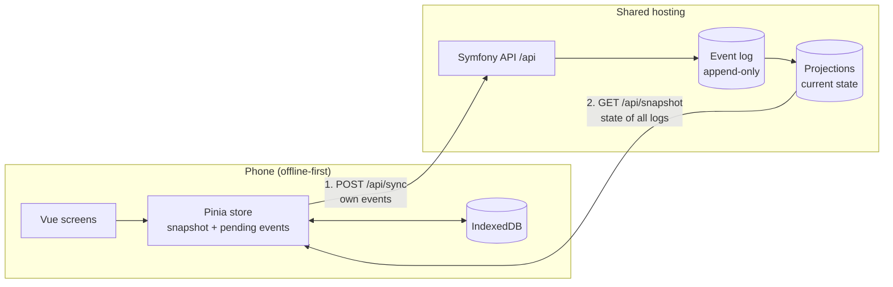

# V29 Stamm-Tracker

An offline-first web app for tracking around 1,300 oak logs – and the beams sawn from them – from the forest to their place in a building.

Built pro bono for **V29**, a collective of architects building a publicly funded residential house in Leipzig from their own low-grade oak ("Schwachholz"). Every log carries a numbered metal tag. Until now, the numbers lived on labels and in an Excel sheet. The Stamm-Tracker replaces that: people in the field capture each log's attributes on their phone, and the data is collected centrally for project management and the research attached to the project.

## How it works

**Capture app** (mobile-first Progressive Web App, installed on the phone's home screen)

1. Type the tag number on a large on-screen number pad – usable with gloves, no barcode scanning.
2. The app shows the log if it already exists, or offers to create it.
3. Record attributes: yes/no, choice, number, text, date, month, measurement series.
4. Split a log into beams. Beams inherit attributes from their log unless they have their own value.
5. Sync by hand once there is a connection: own changes go up, the current state of all logs comes down.

Everything is stored on the device first. Out in the woods there is usually no network, so the app works fully offline – including looking up what is already known about a log.

**Administration** (desktop, planned): manage attributes, correct or void entries, manage users, evaluate and export data.

## Design decisions

- **Offline-first with manual sync.** No background sync – people should know when their data has left the phone.
- **Append-only event log.** Nothing is ever updated or deleted. Every change is an event; corrections and voids are new events. The current state of each log is a projection computed from the events and can be rebuilt at any time. On conflicting values, the one that reached the server last wins.
- **Attributes are configuration, not code.** Everything domain-specific – even the wood species – is an attribute V29 defines themselves. A new process step needs no deployment and no migration.
- **Client-generated IDs.** Every log and every event gets a UUID on the device, so re-sending after a failed sync is harmless (idempotent). The tag number is a label, not the key.
- **Personal invite codes instead of passwords.** Each person gets a code that signs them in for good; it can be revoked individually.
- **Same origin for app and API.** The built app and the Symfony API are served from one host – no CORS, plain session cookies.
- **Boring hosting.** Runs on standard shared hosting (Apache, PHP, MariaDB); no Node.js on the server.



## Status

Work in progress, targeting a first release in November 2026.

- Done: capture app (number pad, logs, attributes, beams with inheritance), offline storage, manual sync, update prompt for new app versions, invite codes, event log with projections, deployment.
- Next: photos, administration, evaluation and export.

## Tech stack

| Part | Technology |
|---|---|
| Capture app | Vue 3 (Composition API, `<script setup>`), TypeScript, Pinia, Vue Router, Tailwind CSS 4, vite-plugin-pwa, IndexedDB via `idb` |
| API | PHP 8.4, Symfony 8, Doctrine ORM and Migrations |
| Database | MariaDB 11.8 |
| Tests | Vitest, Vue Test Utils, Playwright, PHPUnit |
| Tooling | DDEV, ESLint, Prettier, PHP CS Fixer, GitHub Actions |

## Repository layout

```
.
├── backend/              Symfony JSON API under /api
│   ├── src/Controller/   session, snapshot and sync endpoints
│   ├── src/Projection/   computes current state from the event log
│   ├── src/Command/      user management, projection rebuild
│   └── migrations/
├── frontend/             Vue capture app (Progressive Web App)
│   ├── src/api/          API contract (types), fixtures, real and fake client
│   ├── src/stores/       state and domain logic
│   ├── src/persistence/  IndexedDB storage
│   ├── src/views/        screens
│   └── e2e/              Playwright tests
├── docs/
│   ├── prototype/        clickable prototype from the design phase
│   └── prototype-static/ static Tailwind screens used as template for the Vue components
├── .ddev/                local development environment
└── .github/workflows/    deployment
```

The API contract lives in `frontend/src/api/contract.ts`. The JSON fixtures next to it serve both as mock data for the app and as expected results in the backend tests, so frontend and backend cannot drift apart unnoticed.

## Local development

Requirements: [DDEV](https://ddev.com) with a Docker provider (for example OrbStack). Node.js and PHP do not need to be installed on the host – every command runs inside the container.

```sh
ddev start
ddev composer install
ddev frontend install
ddev console doctrine:migrations:migrate -n
ddev console app:attributes:import data/attributes.example.yaml
ddev frontend run dev        # Vite dev server, runs in the foreground
```

- App: https://v29-stamm-tracker.ddev.site:5173 (requests to `/api` are proxied to Symfony)
- API: https://v29-stamm-tracker.ddev.site/api/ping

By default the dev server uses a **fake API** with the fixtures, so the app works without any backend data. To use the real backend, create `frontend/.env.development.local` containing `VITE_API=` and restart Vite. Then create a user:

```sh
ddev console app:user:create "Name" [--admin]
```

The command prints a ready-to-send invite message with the address (from `DEFAULT_URI`), the personal code and install steps for iPhone and Android. The code is shown only once. A browser shows only the install steps; the sign-in form appears in the installed app (and, for local work, on the dev server and with the fake API).

### Commands

| Task | Command |
|---|---|
| Frontend unit tests | `ddev frontend run tests` (watch mode: `ddev frontend run test:unit`) |
| End-to-end tests | `ddev frontend run test:e2e` (builds the app with the fake API and serves it itself, no dev server needed) |
| Build incl. type check | `ddev frontend run build` |
| Lint / format frontend | `ddev frontend run lint` / `ddev frontend run format` |
| Backend tests | `ddev phpunit` |
| Format PHP | `ddev php-cs-fixer fix` |
| Symfony console | `ddev console …` |
| Users | `app:user:create`, `app:user:list`, `app:user:revoke` |
| Rebuild projections from all events | `ddev console app:projections:rebuild` |
| Import attributes from YAML (path relative to `backend/`) | `ddev console app:attributes:import data/attributes.example.yaml [--dry-run]` |
| Testing only: delete events and projections (users stay) | `ddev console app:reset [--attributes] [--force]` |

### Starting a test over

`app:reset` deletes all events and projections (with `--attributes` also attributes and options); users stay signed in. It breaks the append-only event log on purpose and is for test data only. In prod it refuses without `--force`.

Locally, a database snapshot is quicker and also restores the data instead of only deleting it:

```sh
ddev snapshot --name before-test
ddev snapshot restore before-test
```

After a reset, also clear the app's local data on every phone used for the test (delete the home screen app or the site data in the browser settings). Otherwise their pending events are uploaded again at the next sync.

The backend tests use a separate database. Create it once (and repeat the second command after new migrations):

```sh
ddev console --env=test doctrine:database:create
ddev console --env=test doctrine:migrations:migrate -n
```

### Testing on a phone

Service workers and the camera require HTTPS with a trusted certificate, so phones go through a Cloudflare tunnel:

```sh
brew install cloudflared                          # once
ddev frontend run build -- --mode share           # new service worker takes over immediately
ddev share --provider=cloudflared                 # open the printed address on the phone
```

After a new build, reload the page on the phone twice. Restarting `ddev share` yields a new address – a new origin, so local test data on the phone is gone.

### Debugging

`ddev xdebug on` and the VS Code launch configuration "Xdebug (DDEV)" (port 9003). Turn it off again with `ddev xdebug off`, it slows every request down.

## Deployment

Deployment runs as a GitHub Actions workflow (`.github/workflows/deploy.yaml`), started manually – every deploy runs migrations against the live database.

1. Install Composer dependencies without dev packages.
2. Build the frontend; the build copies the app into `backend/public/` next to `index.php`.
3. Upload `backend/` to the server via rsync over SSH. `.rsync-exclude` protects server-only files such as `.env.local` and `var/`.
4. Clear the cache and run migrations on the server.

On the server, `.htaccess` routes `/api/*` and `/admin/*` to Symfony, serves existing files directly and everything else to `index.html`.

**One-time setup**

- Server: create `backend/.env.local` from `backend/.env.local.example`.
- GitHub environment `IONOS` – secrets `SSH_HOST`, `SSH_USERNAME`, `DEPLOY_SSH_PRIVATE_KEY`, `KNOWN_HOST_KEY`, `REMOTE_PATH`; variable `PHP_BIN` (on IONOS, plain `php` is an ancient version, so the path to the PHP 8.4 binary has to be set explicitly).

## Conventions

- Code, comments, commit messages and documentation in English. Content defined by V29 (attribute names, options) and the user interface are German.
- Domain terms in code: log or beam = `timber_item`, attribute = `attribute`, option = `attribute_option`, tag = `tag`.
- Attribute names and options are content – never hard-coded.

## Author

[Alexander Summa](https://alexandersumma.de) – design engineer, responsible for concept, UX, design and development.
