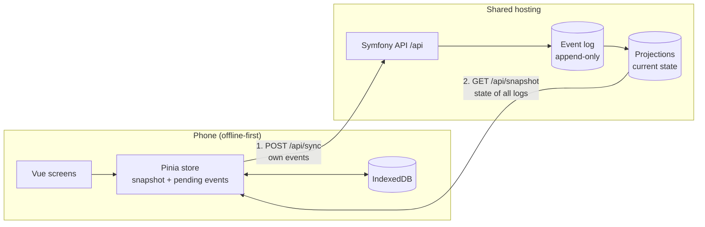

# V29 Stamm-Tracker

An offline-first web app for tracking around 1,300 oak logs – and the beams sawn from them – from the forest to their place in a building.

Built pro bono for **V29**, a collective of architects building a publicly funded residential house in Leipzig from their own low-grade oak ("Schwachholz"). Every log carries a numbered metal tag. Until now, the numbers lived on labels and in an Excel sheet. The Stamm-Tracker replaces that: people in the field capture each log's attributes on their phone, and the data is collected centrally for project management and the research attached to the project.

## How it works

**Capture app** (mobile-first Progressive Web App, installed on the phone's home screen)

1. Type the tag number on a large on-screen number pad – usable with gloves, no barcode scanning.
2. The app shows the log if it already exists, or offers to create it.
3. Record attributes: yes/no, choice, number, text, date, month, measurement series.
4. Split a log into beams. Beams inherit attributes from their log unless they have their own value.
5. Give a log or beam a new tag if its tag is lost or was mixed up.
6. Sync by hand once there is a connection: own changes go up, the current state of all logs comes down. The app also downloads the current state by itself when it opens and when it returns to the foreground (at most once a minute, silently, never uploading); the start screen shows when the data was last downloaded, the counter on the sync button shows what is still waiting for the upload.

Everything is stored on the device first. Out in the woods there is usually no network, so the app works fully offline – including looking up what is already known about a log.

**Administration** (desktop, planned): manage attributes, correct or void entries, manage users, evaluate and export data.

## Design decisions

- **Offline-first with manual upload.** Own entries (later with large photos) leave the phone only when someone taps the sync button – people should know when their data has left the phone. Only the download of the current state runs by itself, when the app opens or returns to the foreground. No timer, no background sync (unreliable on iOS).
- **Append-only event log.** Nothing is ever updated or deleted. Every change is an event; corrections and voids are new events. The current state of each log is a projection computed from the events and can be rebuilt at any time. On conflicting values, the one that reached the server last wins.
- **Attributes are configuration, not code.** Everything domain-specific – even the wood species – is an attribute V29 defines themselves. A new process step needs no deployment and no migration.
- **Client-generated IDs.** Every log and every event gets a UUID on the device, so re-sending after a failed sync is harmless (idempotent). The tag number is a label, not the key.
- **Personal invite codes instead of passwords.** Each person gets a code that signs them in for good; it can be revoked individually.
- **Same origin for app and API.** The built app and the Symfony API are served from one host – no CORS, plain session cookies.
- **Boring hosting.** Runs on standard shared hosting (Apache, PHP, MariaDB); no Node.js on the server.



## Status

Deployed; first use in the field (at the sawmill) planned for the end of October 2026. Development continues.

- Done: capture app (number pad, logs, attributes, beams with inheritance, changing a tag), offline storage, manual sync, update prompt for new app versions, build identifier on the help page, invite codes, event log with projections, voiding entries by console command, deployment.
- Next: photos, administration, evaluation and export.

## Tech stack

| Part | Technology |
|---|---|
| Capture app | Vue 3 (Composition API, `<script setup>`), TypeScript, Pinia, Vue Router, Tailwind CSS 4, vite-plugin-pwa, IndexedDB via `idb` |
| API | PHP 8.4, Symfony 8, Doctrine ORM and Migrations |
| Database | MariaDB 11.8 |
| Tests | Vitest, Vue Test Utils, Playwright, PHPUnit |
| Tooling | DDEV, ESLint, Prettier, PHP CS Fixer, GitHub Actions |

## Repository layout

```
.
├── backend/              Symfony JSON API under /api
│   ├── src/Controller/   session, snapshot and sync endpoints
│   ├── src/Projection/   computes current state from the event log
│   ├── src/Command/      users, attribute import, voiding, export, projection rebuild, test reset
│   ├── data/             attribute definitions (YAML) for the import
│   └── migrations/
├── frontend/             Vue capture app (Progressive Web App)
│   ├── src/api/          API contract (types), fixtures, real and fake client
│   ├── src/stores/       state and domain logic
│   ├── src/persistence/  IndexedDB storage
│   ├── src/views/        screens
│   └── e2e/              Playwright tests
├── docs/
│   ├── prototype/        clickable prototype from the design phase
│   └── prototype-static/ static Tailwind screens used as template for the Vue components
├── .ddev/                local development environment
└── .github/workflows/    deployment
```

The API contract lives in `frontend/src/api/contract.ts`. The JSON fixtures next to it serve both as mock data for the app and as expected results in the backend tests, so frontend and backend cannot drift apart unnoticed.

## Local development

Requirements: [DDEV](https://ddev.com) with a Docker provider (for example OrbStack). Node.js and PHP do not need to be installed on the host – every command runs inside the container.

```sh
ddev start
ddev composer install
ddev frontend install
ddev console doctrine:migrations:migrate -n
ddev console app:user:create "Name" --admin
ddev console app:attributes:import data/attributes.yaml
ddev frontend run dev        # Vite dev server, runs in the foreground
```

`data/attributes.yaml` holds the attributes agreed with V29; `data/attributes.example.yaml` documents every option of the format.

- App: https://v29-stamm-tracker.ddev.site:5173 (requests to `/api` are proxied to Symfony)
- API: https://v29-stamm-tracker.ddev.site/api/ping

The dev server uses a **fake API** with the fixtures by default, so UI work needs no backend data. To use the real backend there, create `frontend/.env.development.local` containing `VITE_API=` and restart Vite. The built app (`ddev frontend run build`, served at https://v29-stamm-tracker.ddev.site) always uses the real API – the way to try out capture as it will run live.

`app:user:create` prints a ready-to-send invite message with the address (from `DEFAULT_URI`), the personal code and install steps for iPhone and Android. The code is shown only once. A browser shows only the install steps; the sign-in form appears in the installed app (and, for local work, on the dev server and with the fake API).

### Commands

| Task | Command |
|---|---|
| Frontend unit tests | `ddev frontend run tests` (watch mode: `ddev frontend run test:unit`) |
| End-to-end tests | `ddev frontend run test:e2e` (builds the app with the fake API and serves it itself, no dev server needed) |
| Build incl. type check | `ddev frontend run build` |
| Lint / format frontend | `ddev frontend run lint` / `ddev frontend run format` |
| Backend tests | `ddev phpunit` |
| Format PHP | `ddev php-cs-fixer fix` |
| Symfony console | `ddev console …` |
| Users | `app:user:create`, `app:user:list`, `app:user:revoke` |
| Void a stem or beam created by mistake or twice (it leaves the snapshot, its tag is free again; a stem only once its beams are voided; recorded under the only admin) | `ddev console app:item:void 123` or `app:item:void 123-A [--force]` |
| Export all stems and beams (current state, without voided) to Excel; without a path `stamm-tracker-export-YYYY-MM-DD-HHMM.xlsx` (Berlin time) in the current directory, see [Excel export](#excel-export) | `ddev console app:export [path.xlsx]` |
| Attach photos to stems and beams from a CSV (`file,tag` or `file;tag`), see [Photos](#photos) | `ddev console app:photo:import photos.csv [--dry-run]` |
| Rebuild projections from all events | `ddev console app:projections:rebuild` |
| Import attributes from YAML (path relative to `backend/`; creates and updates, never deletes) | `ddev console app:attributes:import data/attributes.yaml [--dry-run]` |
| Testing only: delete events and projections (users stay) | `ddev console app:reset [--attributes] [--force]` |

### Excel export

`app:export` writes one sheet with a row per stem or beam: tag (plaque format), type, stem, created, created by, last change, then one column per attribute in attribute order. Inactive attributes appear only if an item has a value for them. Voided items are left out. It reads the same projections as the snapshot, so the file shows what the apps show after a sync.

On IONOS, run it over SSH from the home directory and download the file with `scp`:

```sh
ssh <user>@<host>
cd ~
<PHP_BIN> <REMOTE_PATH>/bin/console app:export   # prints file name and row count
exit
scp <user>@<host>:<file name from the output> .
```

The file lands in the current directory, so run it from the home directory, not from `public/`: it holds all data and `public/` is served on the web. Delete it after downloading. Needed PHP extensions: `zip`, `dom`, `libxml`, `xmlreader`, `filter` (check with `php -m`).

### Photos

Photos are JPEGs, compressed on the device (4032 px long edge, quality 0.85); the server stores them unchanged and rejects files over 10 MB. They live in `var/photos/` (outside `public/`, set another folder with `PHOTO_DIR`) and are served only by `GET /api/photos/{id}` to signed-in users. A photo is an ordinary value of the one photo attribute ("Fotos", a series): the id is synced as an event, the file is uploaded separately via `POST /api/photos`, in any order.

`app:photo:import` attaches existing photos to stems and beams. The CSV has the header `file,tag` or `file;tag` (the separator is taken from the header; quoted fields work as usual), file paths are relative to the CSV, the tag may have leading zeros. Rows with an unknown tag, a missing file, a non-JPEG or a file over 10 MB are skipped and listed at the end. Run `--dry-run` first.

- **Convert the originals only once** (Mac: `sips -Z 4032 -s format jpeg -s formatOptions 85`). Converting again gives different checksums, and the import treats the files as new photos: duplicates are detected by checksum per stem or beam.
- A second run with the same files adds nothing.
- The capture time comes from the EXIF date (`DateTimeOriginal`, read as Berlin time), otherwise from the file date. Needs the PHP extension `exif` (`php -m`).
- The photos are recorded under the only admin, or under the user given with `--user` (name or ID).

**On IONOS**

- Storage: `<REMOTE_PATH>/var/photos/`. The folder is created on the first photo (mode 0750, owner = SSH user, who is also the PHP user on shared hosting – confirm with the first upload). `var/` is excluded from the deploy, so photos survive it.
- The database dump of the on-demand backup does not contain photos; they need their own copy of `var/photos/`.
- After the deploy, add the attribute once with `app:attributes:import data/attributes.yaml` (not on the sawmill days).
- Upload limits of the web server: `curl https://<host>/api/ping` shows `upload_max_filesize` and `post_max_size` in bytes (the command line may have other values).
- Import: copy the photos and `photos.csv` to a folder outside `public/` (e.g. `~/photo-import/`), then:

```sh
cd ~/photo-import
<PHP_BIN> <REMOTE_PATH>/bin/console app:photo:import photos.csv --dry-run
<PHP_BIN> <REMOTE_PATH>/bin/console app:photo:import photos.csv
```

### Starting a test over

`app:reset` deletes all events and projections (with `--attributes` also attributes and options); users stay signed in. It breaks the append-only event log on purpose and is for test data only. It always refuses in prod. Elsewhere it asks for confirmation; with `--no-interaction`, `--force` replaces the confirmation.

Locally, a database snapshot is quicker and also restores the data instead of only deleting it:

```sh
ddev snapshot --name before-test
ddev snapshot restore before-test
```

To start from a completely empty database (users included), recreate it, then create the admin again and take a snapshot to return to:

```sh
ddev console doctrine:database:drop --force
ddev console doctrine:database:create
ddev console doctrine:migrations:migrate -n
ddev console app:user:create "Name" --admin    # note the code, it is shown only once
ddev snapshot --name empty-with-admin
```

The import never deletes: a renamed attribute or option is created anew next to the old one. While the attribute file is still changing, restore the snapshot and import again.

After a reset, also clear the app's local data on every phone used for the test (delete the home screen app or the site data in the browser settings). Otherwise their pending events are uploaded again at the next sync.

The backend tests use a separate database. Create it once (and repeat the second command after new migrations):

```sh
ddev console --env=test doctrine:database:create
ddev console --env=test doctrine:migrations:migrate -n
```

### Testing on a phone

Service workers and the camera require HTTPS with a trusted certificate, so phones go through a Cloudflare tunnel:

```sh
brew install cloudflared                          # once
ddev frontend run build -- --mode share           # new service worker takes over immediately
ddev share --provider=cloudflared                 # open the printed address on the phone
```

After a new build, reload the page on the phone twice. Restarting `ddev share` yields a new address – a new origin, so local test data on the phone is gone.

### Testing the update prompt

Once the app is live, new versions reach phones only through the "Neue Version verfügbar" hint, so test it before every release that touches it. Use the regular build (`registerType: 'prompt'`), never the Vite dev server or `--mode share`: both skip the waiting state, so the hint never appears. Every build gets a new build time and therefore a new service worker – no code change is needed to produce an "update".

**Desktop (Chrome)**

1. `ddev frontend run build`, open https://v29-stamm-tracker.ddev.site (without `:5173`), sign in, capture one or two stems without syncing.
2. DevTools → Application → Service Workers: turn **"Update on reload" off** (otherwise Chrome skips the waiting state).
3. `ddev frontend run build` again, reload the page once.
4. Check:
   - The hint appears on the start screen only. On the capture form it does not; going back to start shows it.
   - The close button hides it.
   - "Aktualisieren" reloads; the help page shows the new build time.
   - Pending (unsynced) stems are still there.

**Phone**

1. `ddev frontend run build` (without `--mode share`), then `ddev share --provider=cloudflared`.
2. Open the address on the phone and add the app to the home screen.
3. Keep `ddev share` running (a restart means a new address and a new origin) and build again.
4. Close the app completely (swipe it away in the app switcher) and reopen it from the icon – the hint should appear.

The browser looks for a new service worker only when the app is opened or reloaded. An app left open in the background shows the hint only after it has been closed and reopened.

### Debugging

`ddev xdebug on` and the VS Code launch configuration "Xdebug (DDEV)" (port 9003). Turn it off again with `ddev xdebug off`, it slows every request down.

## Deployment

Deployment runs as a GitHub Actions workflow (`.github/workflows/deploy.yaml`), started manually – every deploy runs migrations against the live database.

1. Install Composer dependencies without dev packages.
2. Build the frontend; the build copies the app into `backend/public/` next to `index.php`.
3. Upload `backend/` to the server via rsync over SSH. `.rsync-exclude` protects server-only files such as `.env.local` and `var/`.
4. Clear the cache and run migrations on the server.

On the server, `.htaccess` routes `/api/*` and `/admin/*` to Symfony, serves existing files directly and everything else to `index.html`.

**One-time setup**

- Server: create `backend/.env.local` from `backend/.env.local.example`.
- GitHub environment `IONOS` – secrets `SSH_HOST`, `SSH_USERNAME`, `DEPLOY_SSH_PRIVATE_KEY`, `KNOWN_HOST_KEY`, `REMOTE_PATH`; variable `PHP_BIN` (on IONOS, plain `php` is an ancient version, so the path to the PHP 8.4 binary has to be set explicitly).

### Logs and php.ini (IONOS)

- **Symfony errors:** `<REMOTE_PATH>/var/log/prod-YYYY-MM-DD.log`, one file per day, the last 14 are kept. Nothing is written for successful requests and for 404/405. On an error (including 4xx such as a wrong invite code or a rejected sync with 400) the log holds the lines before it from the same request or command run (at most 100). Uncaught exceptions in console commands land there too; handled failures that only print `[ERROR]` (e.g. an unreadable CSV) do not. Invite codes, cookies and request bodies are not logged.
- **PHP errors before Symfony starts:** `<REMOTE_PATH>/var/log/php-errors.log`, set by `public/php.ini`. This file is **not rotated**; delete or truncate it now and then (`: > php-errors.log`).
- `public/php.ini` exists only on the server (ignored by git, kept by the deploy, blocked in `.htaccess` – `/php.ini` answers 403). For our IONOS contract a `php.ini` applies to its own directory only, not to subfolders ([IONOS: customizing PHP settings](https://www.ionos.com/help/hosting/using-php-for-web-projects/customizing-the-php-settings-using-the-phpini-file/)). The documentation does not say whether the file adds to or replaces the default settings, so the template repeats the upload limits. Create it once from the template; the `var/log` folder must exist for PHP to write there:

```sh
cd <REMOTE_PATH>
mkdir -p var/log
sed "s#<REMOTE_PATH>#$(pwd)#" php.ini.example > public/php.ini
curl https://<host>/api/ping    # upload_max_filesize and post_max_size are still 67108864 (64 MB)
```

- Read the logs:

```sh
cd <REMOTE_PATH>/var/log
tail -n 50 prod-$(date +%F).log
grep -h CRITICAL prod-*.log
tail -n 20 php-errors.log
```

**Check after the deploy** (nothing stays in the repo)

- Symfony log: `curl -s -X POST https://<host>/api/session -H 'Content-Type: application/json' -d '{"token":"test"}'` answers 401 and writes an `ERROR` line "Unknown or revoked invite link" in `prod-<today>.log`, preceded by a "Matched route" line. A normal request (`curl https://<host>/api/ping`) and a 404 (`curl https://<host>/api/nothing`) add nothing.
- Console: `<PHP_BIN> bin/console doctrine:query:sql "SELECT * FROM missing_table"` throws, and the exception appears in the same file.
- `php.ini`: over SSH, create `public/boom.php` containing `<?php header('Content-Type: text/plain'); var_dump(ini_get('log_errors'), ini_get('error_log')); trigger_error('user-ini-test', E_USER_ERROR);`, open `https://<host>/boom.php`: it shows `string(1) "1"` and the path to `php-errors.log`, and `tail php-errors.log` shows the error. Delete `public/boom.php` afterwards. If the values are wrong, `public/php.ini` is not read (check the name and the path). `curl https://<host>/api/ping` still shows 67108864.

## Conventions

- Code, comments, commit messages and documentation in English. Content defined by V29 (attribute names, options) and the user interface are German.
- Domain terms in code: log or beam = `timber_item`, attribute = `attribute`, option = `attribute_option`, tag = `tag`.
- Attribute names and options are content – never hard-coded.

## Author

[Alexander Summa](https://alexandersumma.de) – design engineer, responsible for concept, UX, design and development.
